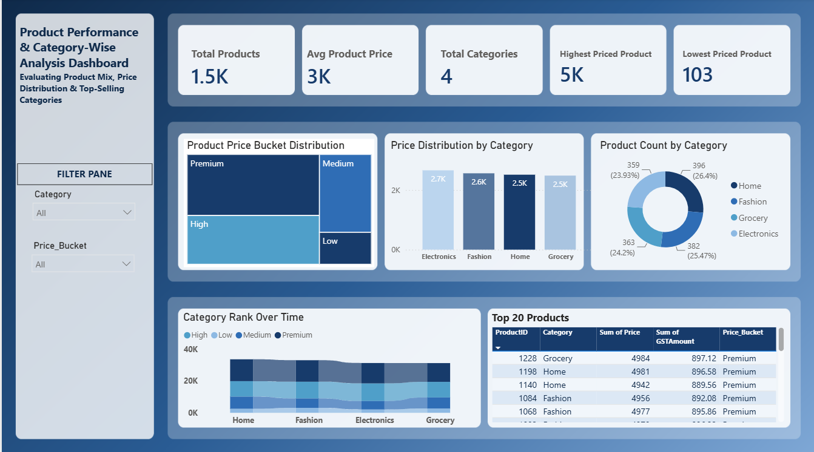

# POWERBI-TASKS
# 📊 Unified Sales, Inventory & Product Analytics Dashboard

An interactive Power BI dashboard designed to bring Sales, Inventory, and Product Analytics together in one place. This project focuses on transforming business data into meaningful insights that can support better decision-making.

## 📸 Dashboard Preview

### Page 1 – Sales Analytics


### Page 2 – Inventory Analytics
<!-- Upload your Inventory Dashboard screenshot here -->

### Page 3 – Product Analytics
<!-- Upload your Product Dashboard screenshot here -->

---

## 🚀 Live Dashboard

**Explore the interactive Power BI dashboard:**

🔗 [Click Here to View Live Dashboard](ADD_YOUR_POWER_BI_PUBLIC_LINK_HERE)

*Note: Replace the link above after publishing your report to Power BI Service.*

---

## 🎯 Project Overview

The Unified Sales, Inventory & Product Analytics Dashboard provides a consolidated view of business performance through three analytical sections.

The dashboard aims to make it easier to explore business data, identify patterns, compare performance, and understand important business metrics.

### 1. Sales Analytics
- Sales performance monitoring
- KPI cards for important business metrics
- Geographical sales analysis
- Category and segment analysis
- Interactive filtering and exploration

### 2. Inventory Analytics
- Inventory-related performance analysis
- Visual comparison of inventory categories
- Interactive exploration using slicers
- Summary of important inventory metrics

### 3. Product Analytics
- Product-level performance analysis
- Product category comparisons
- Visual analysis using charts and tables
- Interactive product exploration

---

## 🛠️ Tools & Technologies

- **Microsoft Power BI** – Dashboard development and visualization
- **Power Query** – Data transformation (where applied)
- **DAX** – Measures and calculations (where applied)
- **Data Visualization** – Charts, KPI cards, maps, tables and slicers

---

## 📂 Repository Structure

```text
Unified-Sales-Inventory-Product-Analytics/
│
├── Unified Sales, Inventory & Product Analytics Dashboard.pbix
│
├── screenshots/
│   ├── sales-dashboard.png
│   ├── inventory-dashboard.png
│   └── product-dashboard.png
│
└── README.md
```

---

## 💡 Key Learning Outcomes

- Building multi-page interactive Power BI reports
- Designing KPI-focused dashboards
- Working with different visualization types
- Using slicers for interactive data exploration
- Presenting business information in a structured format
- Developing analytical thinking and data storytelling skills

---

## ▶️ How to Use

1. Download the `.pbix` file from this repository.
2. Open it using Microsoft Power BI Desktop.
3. Explore the three dashboard pages.
4. Interact with slicers and visualizations.
5. Analyze the available business insights.

---

## 👨‍💻 Author

**Nihal Datkhile**

Aspiring Data Analyst | Power BI | SQL | Excel | Python

- GitHub: [Nihaldatkhile-AI](https://github.com/Nihaldatkhile-AI)
- LinkedIn: [Nihal Datkhile](https://linkedin.com/in/nihal-datkhile)

---

⭐ If you find this project useful, consider giving this repository a star!
